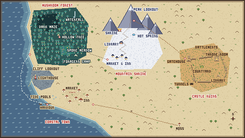

# World & Region Layout (mock)

A first-pass layout of the four regions and the towns inside them. **Layout only, not art.** It's here to settle where things sit before tilemap work or the hand-drawn journal map begins. Sources: GDD §6 (World & Regions), §10 (Overwhelm), §14 (Progression & Travel), and the Fable prompt's region sections.

The in-game version is **`assets/map/map_world.png`**: 480×270 (the locked map size) pixel art with no anti-aliasing. Systems load it through the registry as `AssetRegistry.get_sprite("map_world")`. It is stand-in art, tracked in `assets/temp_assets.md`; the artist's map replaces it by overwriting the same file.

To change the layout, edit the PNG directly in Aseprite or LibreSprite.

## Why the world is shaped this way

The travel routes in GDD §14 fix the geography:

| Route | What it implies |
|---|---|
| Moss's workshop → Coastal Town by road | The game starts inland. Pip is found in the ash on this road. |
| Coast → Forest: "a boat carries the player around the coast" | The forest also borders the sea, further along the same shoreline. |
| Forest → Mountain: "an ancient root passage… emerging at the mountain base" | The forest and mountain are next to each other, joined underground. |
| Mountain → Ruins: "a pilgrim trail down the other side of the mountain" | The ruins lie beyond the mountain pass. |
| Ruins battlements: "all four regions visible" | The ruins sit on a rise with a clear view back to the coast, forest and peak. |

The result is a crescent: coast (SW) → forest (NW) → mountain (N) → ruins (E).

## Rules for laying out each town

1. **The entrance is set by how the player arrives, and the exit by the key gift.** The exit should be visible early, even while it's still closed.
2. **Put the inn at or near the hub.** It's the manual save spot, and in the ending a journal copy gets pinned to each inn's noticeboard.
3. **Overwhelm destinations must be a short, quiet walk from where the overwhelm happens:** market → tide pools (coast), shrine bell → stones by the hot spring (mountain). In the ruins the child is in the tunnels.
4. **Put Pip-ability gates at the edges, not on the main route.** The GDD wants soft gating, with most of each region open from the start.
5. **Each named location is one map-reveal piece.** The journal map reveals "region by region, then location by location."
6. **Scope:** about 4–6 screens per region (one screen = 30×17 tiles). Coastal is the reference region; mock it in detail first.

## Regions

**1 · Coastal Town.** In: the road from the east. Out: a boat from the harbour.
The lighthouse should be visible from the harbour (the restored lantern "lights the harbour"). The tide pools sit just below the market, down toward the shore.

**2 · Mushroom Forest.** In: the boat lands at the forest's sea edge, near the forager's camp. Out: the root passage under the hollow tree.
The spore meadow is open and bright just inside. The hollow tree village is the hub. The dark maze (needs Pip) lies between the village and the mossy waterfall, where the forest child's shrine appears on the return trip.

**3 · Mountain Shrine Town.** In: the root passage, at the base. Out: the pilgrim trail over the pass.
Lay this one out vertically: market + inn at the base → winding steps → shrine, hot spring and the sealed temple library mid-slope → peak lookout at the top.

**4 · Castle Ruins.** In: the pilgrim trail, through the gatehouse. Out: none (climax).
Gatehouse → courtyard garden (hub) → throne room (Wren) deepest in. The battlements go up, facing west toward the other regions. The tunnels go down; keep their entrance visible, since the children leave offerings there on the return. Energy-neutralisation zones guard the deeper rooms.

## Open questions

- **Coastal market:** the overwhelm moment needs a market, but GDD §6 doesn't list one for the coast. The mock adds one.
- **Inns:** the ending puts a noticeboard at an inn in every region, but only the coast lists an inn. The mock places the mountain's inn with its market. The forest and ruins still need one (hollow tree village? a camp in the gatehouse?).
- **Getting back:** all regions stay open, and the return journey revisits each one. Is going back by walking the routes in reverse, or by choosing from the journal map?
